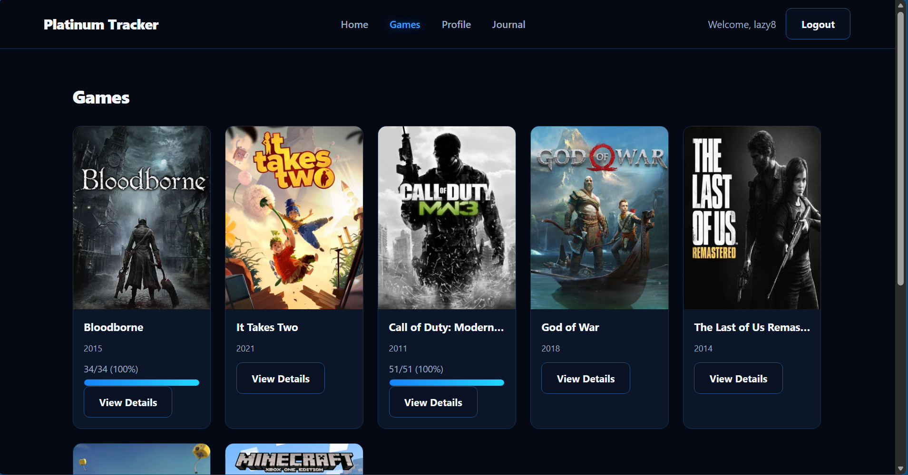
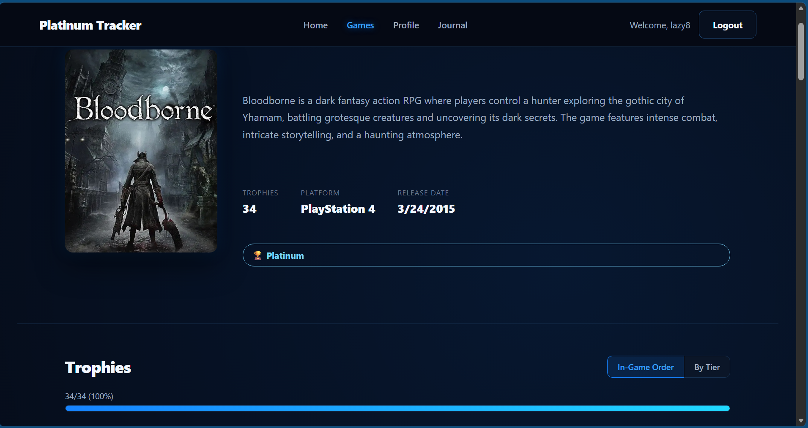
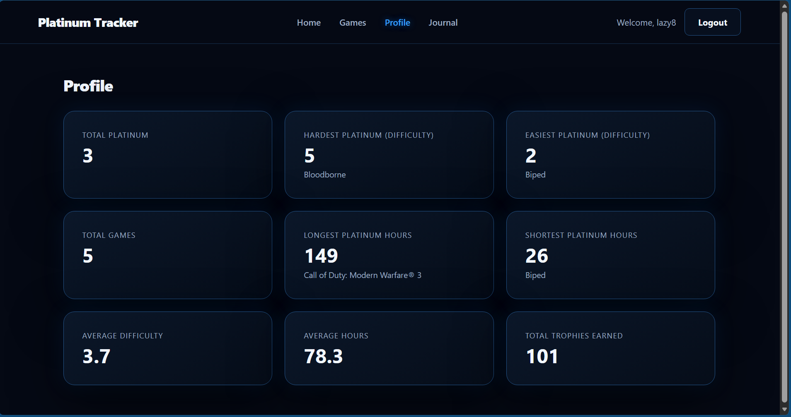
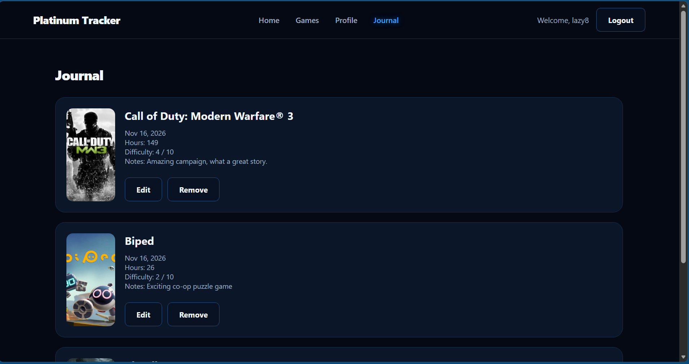

# Platinum Tracker

A Letterboxd-style tracker for PlayStation Platinum hunters.

🔗 Live: [platinum-tracker.onrender.com](https://platinum-tracker.onrender.com)

Note: The free-tier deployment may take about a minute to wake up on the first visit. If the site appears slow initially, wait a moment and refresh.

# About

Platinum Tracker is a personal trophy-tracking application for PlayStation players who want more than the basic trophy list provided by the console. It lets users browse seeded games, track individual trophy progress, record their Platinum experiences, and review their history in a personal Journal. Players can also record optional difficulty, hours spent, and notes for each Platinum. The project is designed for trophy hunters who want a focused way to track and reflect on their Platinum progress.

# Screenshots

## Games

## Game Details

## Profile

## Journal

# Features

- Browse a library of PlayStation games and trophy lists.
- View trophy progress for each game.
- Mark individual trophies as earned.
- Track progress toward a Platinum.
- Record a personal difficulty rating.
- Record hours spent on a Platinum.
- Add notes about a Platinum experience.
- Create a Platinum record after earning all trophies.
- Edit Platinum details from the Journal.
- Remove a Platinum record while keeping the rest of your trophy progress.
- View personal Platinum statistics.
- View completed Platinums in a personal Journal.
- Register an account and securely log in.

# Tech Stack

## Languages

- JavaScript
- SQL
- HTML
- CSS

## Frontend

- React
- React Router
- Vite
- Plain CSS with design tokens — no UI framework

## Backend

- Node.js
- Express
- Prisma

## Database

- PostgreSQL (Neon)

## Auth and Validation

- JWT in HttpOnly cookies
- bcrypt
- express-validator

## Deployment

- Render
- GitHub

# Run Locally

Prerequisites

Install:
- Node.js
- a PostgreSQL database (a free Neon project works)
- Git

1. Clone the repository

git clone [https://github.com/AdolfoCabrera88/platinum-tracker.git]
cd [platinum-tracker]

2. Install backend dependencies

cd backend
npm install

3. Install frontend dependencies

Open another terminal:

cd frontend
npm install

4. Create the backend environment file

Create: `backend/.env`

Add the following variables:

Variable                                 Description

DATABASE_URL= your_neon_database_url        (PostgreSQL connection string for the Neon database.)

JWT_SECRET= your_generated_secret     (Secret used to sign and verify JWT authentication tokens.)

JWT_EXPIRATION_TIME= 3600        (JWT lifetime in seconds. The application converts this value to milliseconds when creating the token expiration time.) **Important:** `JWT_EXPIRATION_TIME=3600` is just an example meaning **1 hour**, not a required value.

CLIENT_ORIGIN= http://localhost:5173             (Frontend origin allowed to make requests to the backend. For local development, use http://localhost:5173.)

Generate a JWT secret
You can generate a secure random secret with: 

node -e "console.log(require('crypto').randomBytes(32).toString('hex'))" 

Copy the generated value into JWT_SECRET.
Never commit your real .env file or secret values to Git.

5. Configure the frontend

Create: `frontend/.env`

A template is provided in `frontend/.env.example`.

Add
Variable                                         Description
VITE_API_URL= http://localhost:3000/api         (Base URL used by the frontend to communicate with the backend API)

6. Set up the database

From the backend directory, Generate prisma:
npx prisma generate

Then run the project`s Prisma migration command:
npx prisma migrate deploy

Then seed the database:
npm run seed

The seed data provides the games and trophies needed to use the application immediately.

7. Start the backend
From backend:
npm start

The backend runs on:
http://localhost:3000

8. Start the frontend
From frontend:
npm run dev

The frontend runs on:
http://localhost:5173

Open the frontend URL shown by Vite in your browser.

# Security

The application currently uses several security measures:
- bcrypt hashes user passwords before they are stored.
- HttpOnly cookies prevent client-side JavaScript from directly accessing the authentication token.
- Server-side validation validates user input before database operations.
- express-validator provides request validation for applicable API inputs.
- Prisma uses parameterized database queries rather than constructing SQL queries from user input.
- Authentication-protected routes verify the user`s JWT before allowing protected operations.

Additional hardening planned after the current implementation includes Helmet for HTTP security headers and rate limiting for sensitive API endpoints.

# API Overview

The backend exposes a REST-style API under /api.

Authentication:

POST   /api/auth/register
POST   /api/auth/login
POST   /api/auth/logout
GET    /api/auth/me

Games and trophies:

GET    /api/games
GET    /api/games/:id

Trophy progress:

PATCH /api/trophies/:trophyId/progress

Platinum records:

POST    /api/games/:id/platinum
PATCH   /api/games/:id/platinum
DELETE  /api/games/:id/platinum

User profile and journal:

GET    /api/profile/stats
GET    /api/profile/journal
POST   /api/games/:id/library

The Platinum endpoints require authentication and only allow users to modify their own Platinum records.

# Design Decisions

## Seeded Data Instead of Live PSN Data

I chose to seed the game and trophy data so the application has a reliable dataset for development and demonstrations. This also lets me control the data structure and test trophy-progress logic without making the core application dependent on an external service.

## No PlayStation Network Integration

I did not build PSN integration because PlayStation does not provide an official public API for the data I would need. The unofficial approach requires users to provide an NPSSO token, which is effectively as sensitive as a password, so I would only consider building PSN sync with a strict never-store policy for that credential.

## HttpOnly Cookies

I initially had to debug authentication around the login/register flow, including a register route that successfully created the account but did not set the authentication cookie. Using an HttpOnly cookie keeps the JWT out of localStorage and makes the browser responsible for sending the authentication credential while the server validates it.

## Same-Origin Deployment

I deployed the frontend and backend through the same service architecture so the authentication cookie could work without unnecessary cross-origin complexity. This decision became especially important while debugging the cookie flow because the browser, frontend, and backend need to agree on how the cookie is scoped and sent.

## Optional Ratings

I made hours spent and personal difficulty optional after a friend tested the form by entering `0` hours just to see what would happen. That exposed a real data-quality problem: if a field is required when the user does not actually have a value, users can enter meaningless numbers, so the application allows the field to remain empty and validates real values on the server.

## Neon Database Connection

During development, one of my Neon migrations failed when I tried running it through the pooled database connection. That forced me to understand the difference between Neon’s pooled connection and the connection that should be used for database migrations, rather than treating the database URL as a black box.

# Testing

At the moment, the application has undergone manual testing using the major flows such as authentication, tracking of trophies, creation, editing, deletion of platinum, journal and profile features.

At the moment there is no automation test.

# Known Limitations

- The free-tier deployment can experience cold starts when the service has been inactive.
- Game and trophy data is currently hand-seeded rather than imported automatically.
- Game cover images are hosted in the repository.
- There is currently no PlayStation Network synchronization.
- Community-generated difficulty ratings are not currently available.
- The application does not currently support editing the original Platinum date.

# Next Steps — v2

- Planned improvements include:
- Wishlist support.
- Community difficulty ratings.
- Editing the Platinum date.
- Additional game and trophy data.
- Further improvements to the tracking and profile experience.